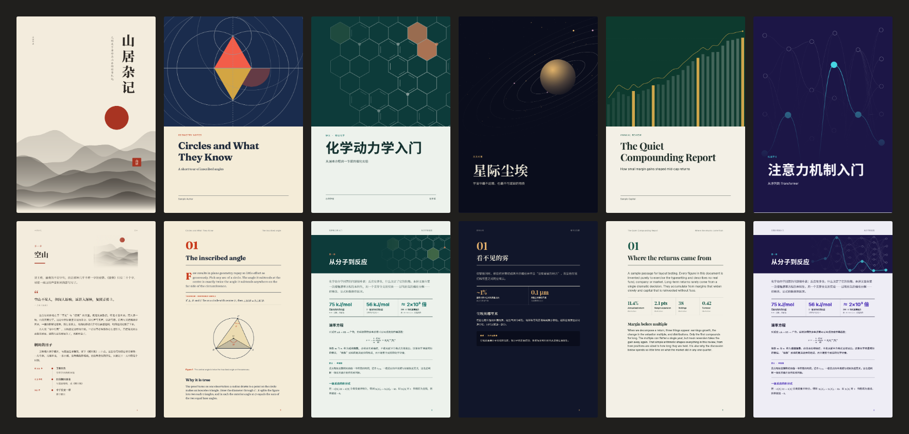

# PDF 工坊 · dsh-pdf-atelier

让 [DeepSeek Harness](https://github.com/deepseek-ai/deepseek-harness) 交付真正有品味的 PDF。模型只管写内容，配色、字体、间距、封面、章节页、目录和页眉都由插件根据文档主题决定，绝不是白底黑字。



## 它做什么

装上之后，你只要说「把这些做成 PDF」。模型会调用 `atelier_pdf`，写一份带扩展语法的 Markdown，插件负责其余全部：

- **主题跟着内容走。** 插件读标题、简介和正文，在 13 套完整的设计方向里选一套。化学用试剂青配六元环分子纹样，数学用致敬 Byrne《几何原本》的三原色，古典文学用宣纸朱砂配竖排书名和印章，天文通篇深色配星轨，财报用墨绿配黄铜。
- **每份文档都有自己的封面。** 封面和章节页的矢量插图由标题生成，同一份文档每次相同，不同文档各不相同。也可以传入自己的图片。
- **版式是设计好的。** 真实页码的目录、章节页、带章名的页眉、分部页、自动编号的图表、不跨页的图注。中文排版按中文规矩来：中西文自动留白、全角引号、标点挤压。
- **读得出问题。** 生成后插件把 PDF 读回来，自动收紧版式以消除只剩几行的尾页，并把「这一章连续 1500 字没有任何图」这样的评审意见返回给模型，让它改完再交付。

它还包含 [`@jaxzhou/dsh-mathmatic-symbol`](https://github.com/jaxzhou/dsh-mathmatic-symbol) 的全部功能（MIT 协议，作为依赖使用），工具改了名，所以两个插件同时开启也不会冲突。

## 工具

| 工具 | 做什么 |
|---|---|
| `atelier_pdf` | 扩展 Markdown → 完整设计好的 PDF |
| `atelier_themes` | 列出设计方向，并按主题排序 |
| `atelier_formula` | LaTeX → 不依赖字体的 SVG / PNG |
| `atelier_figure` | 声明式几何图、函数图 → SVG / PNG |
| `atelier_convert` | 公式、SVG 或图片文件 → 可嵌入的图片，并清洗外来 SVG |
| `atelier_document` | 把公式和图形都插好，生成 Markdown / HTML / LaTeX 文档 |

## 正文语法

普通 Markdown（含表格和代码高亮）之外，还可以用：

````markdown
# 一级标题是一章，有专门的章节页

行内公式 $E=mc^2$，行间公式 $$\int_0^1 x\,dx$$


```chart
{"type":"bar","x":["甲","乙"],"series":[{"name":"","values":[3,5]}],"caption":"图表的颜色来自主题"}
```

```figure
{"elements":[{"type":"curve","y":"sin(x)"}],"caption":"函数和几何图"}
```

Table: 紧贴表格前的这一行是表注。

| 名称 | 数值 |
|---|---|
| 甲 | 12.5 |

:::key 三个结论
读者必须记住的那件事。
:::

:::stats
- 42% | 指标名 | 小字说明
:::
````

组件：`key`、`note`、`tip`、`warn`、`example`、`summary`、`theorem`、`definition`、`lemma`、`proof`、`lead`、`quote`、`stats`、`steps`、`timeline`、`glossary`、`cards`、`columns`、`compare`、`aside`、`part`、`pagebreak`。

## 设计方向

| id | 名称 | 适合 |
|---|---|---|
| `xuan` | 宣纸朱砂 | 文史、哲学、古典、散文 |
| `reagent` | 试剂青 | 化学、材料、实验报告 |
| `euclid` | 欧几里得 | 数学、几何、逻辑 |
| `nocturne` | 夜航 | 天文、宇宙、物理前沿（通篇深色） |
| `moss` | 苔原 | 生态、农业、地理、气候 |
| `ledger` | 账簿 | 金融、经济、咨询、年报 |
| `graphite` | 石墨 | 软件、工程、技术文档 |
| `synapse` | 突触 | 人工智能、机器学习、算法 |
| `tide` | 潮汐 | 医学、公共卫生、海洋、物理 |
| `chlorophyll` | 叶绿 | 生物、基因、神经科学 |
| `terra` | 赤陶 | 艺术、设计、建筑 |
| `plum` | 梅子 | 心理、教育、社会、人物 |
| `playground` | 游乐场 | 儿童、入门教程、科普 |

可以用 `theme` 指定，用 `palette` 覆盖颜色（如品牌色），用 `motif` 换插图。覆盖的颜色若对比度不足，插件会自动修正。

## 安装

在 DeepSeek Harness 里打开「插件 → 添加插件」，填：

```
github:FelixJiashengFu/dsh-pdf-atelier
```

也可以用命令行（桌面版的 profile 需要先完全退出应用）：

```bash
dsh plugin --profile desktop add github:FelixJiashengFu/dsh-pdf-atelier
```

需要本机有 Chrome、Edge 或 Chromium（Windows 自带 Edge）。如果装在特殊位置，在 profile 的 `cordis.patch.yml` 里配置：

```yaml
- id: pdf-atelier
  config:
    chromePath: 'C:\path\to\chrome.exe'
    outputDir: atelier-assets   # 公式和图形工具的产物目录
```

## 已知限制

- 打印要靠本机浏览器。找不到时工具会直接报错，不会悄悄降级成难看的 PDF。
- 字体为可变字体，Chrome 把它们以 Type 3 形式嵌入 PDF。屏幕和打印效果都正常，文字可搜索、可复制，但 Acrobat 里小字号下的渲染比普通嵌入字体略虚。
- 公式和 `atelier_figure` 的图是矢量轮廓，里面的文字不能选中。图表（`chart`）的文字可以选中。
- 不抓取远程图片，也不联网。图片要先存到工作区。
- 主题选择靠关键词。主题冷门时会退回到按标题选定的通用方向，这时传 `theme` 更好。

## 开发

```bash
npm install
npm test
npm run samples
```

`npm run fonts` 从开发依赖里挑出主题用到的字体文件，重新生成 `assets/fonts`。

字体均为 SIL OFL 协议：Noto Serif SC、Noto Sans SC、Fraunces、Source Serif 4、Inter、JetBrains Mono、Playfair Display、霞鹜文楷，许可证随字体文件一起分发。

## 许可证

MIT
