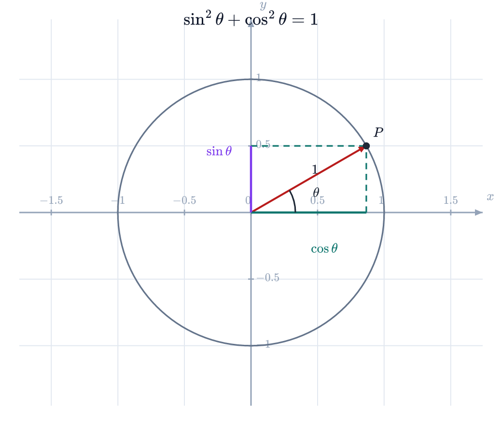

:::part 第一部分的名字
:::

# 第 1 个主题的展开

第 1 段用于检验长文档的分页表现。这里的文字只是排版测试用的占位内容，不陈述任何事实：段落有长有短，行距和字距需要保持稳定，中文与 English 混排时应当自动留出间隙，数字 37 也一样。标点不能出现在行首，“引号”和（括号）要贴紧相邻的文字。

## 小节 1.1

第 11 段用于检验长文档的分页表现。这里的文字只是排版测试用的占位内容，不陈述任何事实：段落有长有短，行距和字距需要保持稳定，中文与 English 混排时应当自动留出间隙，数字 407 也一样。标点不能出现在行首，“引号”和（括号）要贴紧相邻的文字。

第 12 段用于检验长文档的分页表现。这里的文字只是排版测试用的占位内容，不陈述任何事实：段落有长有短，行距和字距需要保持稳定，中文与 English 混排时应当自动留出间隙，数字 444 也一样。标点不能出现在行首，“引号”和（括号）要贴紧相邻的文字。

:::stats
- 11% | 占位指标甲 | 测试数据
- 3 项 | 占位指标乙 | 测试数据
- 1.1 | 占位指标丙 | 测试数据
:::

## 小节 1.2

第 12 段用于检验长文档的分页表现。这里的文字只是排版测试用的占位内容，不陈述任何事实：段落有长有短，行距和字距需要保持稳定，中文与 English 混排时应当自动留出间隙，数字 444 也一样。标点不能出现在行首，“引号”和（括号）要贴紧相邻的文字。

第 13 段用于检验长文档的分页表现。这里的文字只是排版测试用的占位内容，不陈述任何事实：段落有长有短，行距和字距需要保持稳定，中文与 English 混排时应当自动留出间隙，数字 481 也一样。标点不能出现在行首，“引号”和（括号）要贴紧相邻的文字。

```chart
{"type":"line","x":["甲","乙","丙","丁","戊"],"series":[{"name":"测试","values":[1,2,4,3,2]}],"caption":"测试图表 1.2，数据为占位。"}
```

## 小节 1.3

第 13 段用于检验长文档的分页表现。这里的文字只是排版测试用的占位内容，不陈述任何事实：段落有长有短，行距和字距需要保持稳定，中文与 English 混排时应当自动留出间隙，数字 481 也一样。标点不能出现在行首，“引号”和（括号）要贴紧相邻的文字。

第 14 段用于检验长文档的分页表现。这里的文字只是排版测试用的占位内容，不陈述任何事实：段落有长有短，行距和字距需要保持稳定，中文与 English 混排时应当自动留出间隙，数字 518 也一样。标点不能出现在行首，“引号”和（括号）要贴紧相邻的文字。



:::note 小结
第 1 段用于检验长文档的分页表现。这里的文字只是排版测试用的占位内容，不陈述任何事实：段落有长有短，行距和字距需要保持稳定，中文与 English 混排时应当自动留出间隙，数字 37 也一样。标点不能出现在行首，“引号”和（括号）要贴紧相邻的文字。
:::

### 更细一层

第 101 段用于检验长文档的分页表现。这里的文字只是排版测试用的占位内容，不陈述任何事实：段落有长有短，行距和字距需要保持稳定，中文与 English 混排时应当自动留出间隙，数字 3737 也一样。标点不能出现在行首，“引号”和（括号）要贴紧相邻的文字。

# 第 2 个主题的展开

第 2 段用于检验长文档的分页表现。这里的文字只是排版测试用的占位内容，不陈述任何事实：段落有长有短，行距和字距需要保持稳定，中文与 English 混排时应当自动留出间隙，数字 74 也一样。标点不能出现在行首，“引号”和（括号）要贴紧相邻的文字。

## 小节 2.1

第 21 段用于检验长文档的分页表现。这里的文字只是排版测试用的占位内容，不陈述任何事实：段落有长有短，行距和字距需要保持稳定，中文与 English 混排时应当自动留出间隙，数字 777 也一样。标点不能出现在行首，“引号”和（括号）要贴紧相邻的文字。

第 22 段用于检验长文档的分页表现。这里的文字只是排版测试用的占位内容，不陈述任何事实：段落有长有短，行距和字距需要保持稳定，中文与 English 混排时应当自动留出间隙，数字 814 也一样。标点不能出现在行首，“引号”和（括号）要贴紧相邻的文字。

:::stats
- 22% | 占位指标甲 | 测试数据
- 6 项 | 占位指标乙 | 测试数据
- 2.1 | 占位指标丙 | 测试数据
:::

## 小节 2.2

第 22 段用于检验长文档的分页表现。这里的文字只是排版测试用的占位内容，不陈述任何事实：段落有长有短，行距和字距需要保持稳定，中文与 English 混排时应当自动留出间隙，数字 814 也一样。标点不能出现在行首，“引号”和（括号）要贴紧相邻的文字。

第 23 段用于检验长文档的分页表现。这里的文字只是排版测试用的占位内容，不陈述任何事实：段落有长有短，行距和字距需要保持稳定，中文与 English 混排时应当自动留出间隙，数字 851 也一样。标点不能出现在行首，“引号”和（括号）要贴紧相邻的文字。

```chart
{"type":"bar","x":["甲","乙","丙","丁","戊"],"series":[{"name":"测试","values":[2,4,5,6,3]}],"caption":"测试图表 2.2，数据为占位。"}
```

## 小节 2.3

第 23 段用于检验长文档的分页表现。这里的文字只是排版测试用的占位内容，不陈述任何事实：段落有长有短，行距和字距需要保持稳定，中文与 English 混排时应当自动留出间隙，数字 851 也一样。标点不能出现在行首，“引号”和（括号）要贴紧相邻的文字。

第 24 段用于检验长文档的分页表现。这里的文字只是排版测试用的占位内容，不陈述任何事实：段落有长有短，行距和字距需要保持稳定，中文与 English 混排时应当自动留出间隙，数字 888 也一样。标点不能出现在行首，“引号”和（括号）要贴紧相邻的文字。


:::note 小结
第 2 段用于检验长文档的分页表现。这里的文字只是排版测试用的占位内容，不陈述任何事实：段落有长有短，行距和字距需要保持稳定，中文与 English 混排时应当自动留出间隙，数字 74 也一样。标点不能出现在行首，“引号”和（括号）要贴紧相邻的文字。
:::

### 更细一层

第 102 段用于检验长文档的分页表现。这里的文字只是排版测试用的占位内容，不陈述任何事实：段落有长有短，行距和字距需要保持稳定，中文与 English 混排时应当自动留出间隙，数字 3774 也一样。标点不能出现在行首，“引号”和（括号）要贴紧相邻的文字。

# 第 3 个主题的展开

第 3 段用于检验长文档的分页表现。这里的文字只是排版测试用的占位内容，不陈述任何事实：段落有长有短，行距和字距需要保持稳定，中文与 English 混排时应当自动留出间隙，数字 111 也一样。标点不能出现在行首，“引号”和（括号）要贴紧相邻的文字。

## 小节 3.1

第 31 段用于检验长文档的分页表现。这里的文字只是排版测试用的占位内容，不陈述任何事实：段落有长有短，行距和字距需要保持稳定，中文与 English 混排时应当自动留出间隙，数字 1147 也一样。标点不能出现在行首，“引号”和（括号）要贴紧相邻的文字。

第 32 段用于检验长文档的分页表现。这里的文字只是排版测试用的占位内容，不陈述任何事实：段落有长有短，行距和字距需要保持稳定，中文与 English 混排时应当自动留出间隙，数字 1184 也一样。标点不能出现在行首，“引号”和（括号）要贴紧相邻的文字。

:::stats
- 33% | 占位指标甲 | 测试数据
- 9 项 | 占位指标乙 | 测试数据
- 3.1 | 占位指标丙 | 测试数据
:::

## 小节 3.2

第 32 段用于检验长文档的分页表现。这里的文字只是排版测试用的占位内容，不陈述任何事实：段落有长有短，行距和字距需要保持稳定，中文与 English 混排时应当自动留出间隙，数字 1184 也一样。标点不能出现在行首，“引号”和（括号）要贴紧相邻的文字。

第 33 段用于检验长文档的分页表现。这里的文字只是排版测试用的占位内容，不陈述任何事实：段落有长有短，行距和字距需要保持稳定，中文与 English 混排时应当自动留出间隙，数字 1221 也一样。标点不能出现在行首，“引号”和（括号）要贴紧相邻的文字。

```chart
{"type":"line","x":["甲","乙","丙","丁","戊"],"series":[{"name":"测试","values":[3,6,6,9,4]}],"caption":"测试图表 3.2，数据为占位。"}
```

## 小节 3.3

第 33 段用于检验长文档的分页表现。这里的文字只是排版测试用的占位内容，不陈述任何事实：段落有长有短，行距和字距需要保持稳定，中文与 English 混排时应当自动留出间隙，数字 1221 也一样。标点不能出现在行首，“引号”和（括号）要贴紧相邻的文字。

第 34 段用于检验长文档的分页表现。这里的文字只是排版测试用的占位内容，不陈述任何事实：段落有长有短，行距和字距需要保持稳定，中文与 English 混排时应当自动留出间隙，数字 1258 也一样。标点不能出现在行首，“引号”和（括号）要贴紧相邻的文字。


:::note 小结
第 3 段用于检验长文档的分页表现。这里的文字只是排版测试用的占位内容，不陈述任何事实：段落有长有短，行距和字距需要保持稳定，中文与 English 混排时应当自动留出间隙，数字 111 也一样。标点不能出现在行首，“引号”和（括号）要贴紧相邻的文字。
:::

### 更细一层

第 103 段用于检验长文档的分页表现。这里的文字只是排版测试用的占位内容，不陈述任何事实：段落有长有短，行距和字距需要保持稳定，中文与 English 混排时应当自动留出间隙，数字 3811 也一样。标点不能出现在行首，“引号”和（括号）要贴紧相邻的文字。

Table: 长表格跨页测试（占位）。

| 序号 | 名称 | 数值 | 备注 |
|---|---|---|---|
| 1 | 条目 1 | 3.14 | 占位说明文字 |
| 2 | 条目 2 | 6.28 | 占位说明文字 |
| 3 | 条目 3 | 9.42 | 占位说明文字 |
| 4 | 条目 4 | 12.56 | 占位说明文字 |
| 5 | 条目 5 | 15.70 | 占位说明文字 |
| 6 | 条目 6 | 18.84 | 占位说明文字 |
| 7 | 条目 7 | 21.98 | 占位说明文字 |
| 8 | 条目 8 | 25.12 | 占位说明文字 |
| 9 | 条目 9 | 28.26 | 占位说明文字 |
| 10 | 条目 10 | 31.40 | 占位说明文字 |
| 11 | 条目 11 | 34.54 | 占位说明文字 |
| 12 | 条目 12 | 37.68 | 占位说明文字 |
| 13 | 条目 13 | 40.82 | 占位说明文字 |
| 14 | 条目 14 | 43.96 | 占位说明文字 |
| 15 | 条目 15 | 47.10 | 占位说明文字 |
| 16 | 条目 16 | 50.24 | 占位说明文字 |
| 17 | 条目 17 | 53.38 | 占位说明文字 |
| 18 | 条目 18 | 56.52 | 占位说明文字 |
| 19 | 条目 19 | 59.66 | 占位说明文字 |
| 20 | 条目 20 | 62.80 | 占位说明文字 |
| 21 | 条目 21 | 65.94 | 占位说明文字 |
| 22 | 条目 22 | 69.08 | 占位说明文字 |
| 23 | 条目 23 | 72.22 | 占位说明文字 |
| 24 | 条目 24 | 75.36 | 占位说明文字 |
| 25 | 条目 25 | 78.50 | 占位说明文字 |
| 26 | 条目 26 | 81.64 | 占位说明文字 |
| 27 | 条目 27 | 84.78 | 占位说明文字 |
| 28 | 条目 28 | 87.92 | 占位说明文字 |
| 29 | 条目 29 | 91.06 | 占位说明文字 |
| 30 | 条目 30 | 94.20 | 占位说明文字 |

# 第 4 个主题的展开

第 4 段用于检验长文档的分页表现。这里的文字只是排版测试用的占位内容，不陈述任何事实：段落有长有短，行距和字距需要保持稳定，中文与 English 混排时应当自动留出间隙，数字 148 也一样。标点不能出现在行首，“引号”和（括号）要贴紧相邻的文字。

## 小节 4.1

第 41 段用于检验长文档的分页表现。这里的文字只是排版测试用的占位内容，不陈述任何事实：段落有长有短，行距和字距需要保持稳定，中文与 English 混排时应当自动留出间隙，数字 1517 也一样。标点不能出现在行首，“引号”和（括号）要贴紧相邻的文字。

第 42 段用于检验长文档的分页表现。这里的文字只是排版测试用的占位内容，不陈述任何事实：段落有长有短，行距和字距需要保持稳定，中文与 English 混排时应当自动留出间隙，数字 1554 也一样。标点不能出现在行首，“引号”和（括号）要贴紧相邻的文字。

:::stats
- 44% | 占位指标甲 | 测试数据
- 12 项 | 占位指标乙 | 测试数据
- 4.1 | 占位指标丙 | 测试数据
:::

## 小节 4.2

第 42 段用于检验长文档的分页表现。这里的文字只是排版测试用的占位内容，不陈述任何事实：段落有长有短，行距和字距需要保持稳定，中文与 English 混排时应当自动留出间隙，数字 1554 也一样。标点不能出现在行首，“引号”和（括号）要贴紧相邻的文字。

第 43 段用于检验长文档的分页表现。这里的文字只是排版测试用的占位内容，不陈述任何事实：段落有长有短，行距和字距需要保持稳定，中文与 English 混排时应当自动留出间隙，数字 1591 也一样。标点不能出现在行首，“引号”和（括号）要贴紧相邻的文字。

```chart
{"type":"bar","x":["甲","乙","丙","丁","戊"],"series":[{"name":"测试","values":[4,8,7,12,5]}],"caption":"测试图表 4.2，数据为占位。"}
```

## 小节 4.3

第 43 段用于检验长文档的分页表现。这里的文字只是排版测试用的占位内容，不陈述任何事实：段落有长有短，行距和字距需要保持稳定，中文与 English 混排时应当自动留出间隙，数字 1591 也一样。标点不能出现在行首，“引号”和（括号）要贴紧相邻的文字。

第 44 段用于检验长文档的分页表现。这里的文字只是排版测试用的占位内容，不陈述任何事实：段落有长有短，行距和字距需要保持稳定，中文与 English 混排时应当自动留出间隙，数字 1628 也一样。标点不能出现在行首，“引号”和（括号）要贴紧相邻的文字。


:::note 小结
第 4 段用于检验长文档的分页表现。这里的文字只是排版测试用的占位内容，不陈述任何事实：段落有长有短，行距和字距需要保持稳定，中文与 English 混排时应当自动留出间隙，数字 148 也一样。标点不能出现在行首，“引号”和（括号）要贴紧相邻的文字。
:::

### 更细一层

第 104 段用于检验长文档的分页表现。这里的文字只是排版测试用的占位内容，不陈述任何事实：段落有长有短，行距和字距需要保持稳定，中文与 English 混排时应当自动留出间隙，数字 3848 也一样。标点不能出现在行首，“引号”和（括号）要贴紧相邻的文字。

:::part 第二部分的名字
:::

# 第 5 个主题的展开

第 5 段用于检验长文档的分页表现。这里的文字只是排版测试用的占位内容，不陈述任何事实：段落有长有短，行距和字距需要保持稳定，中文与 English 混排时应当自动留出间隙，数字 185 也一样。标点不能出现在行首，“引号”和（括号）要贴紧相邻的文字。

## 小节 5.1

第 51 段用于检验长文档的分页表现。这里的文字只是排版测试用的占位内容，不陈述任何事实：段落有长有短，行距和字距需要保持稳定，中文与 English 混排时应当自动留出间隙，数字 1887 也一样。标点不能出现在行首，“引号”和（括号）要贴紧相邻的文字。

第 52 段用于检验长文档的分页表现。这里的文字只是排版测试用的占位内容，不陈述任何事实：段落有长有短，行距和字距需要保持稳定，中文与 English 混排时应当自动留出间隙，数字 1924 也一样。标点不能出现在行首，“引号”和（括号）要贴紧相邻的文字。

:::stats
- 55% | 占位指标甲 | 测试数据
- 15 项 | 占位指标乙 | 测试数据
- 5.1 | 占位指标丙 | 测试数据
:::

## 小节 5.2

第 52 段用于检验长文档的分页表现。这里的文字只是排版测试用的占位内容，不陈述任何事实：段落有长有短，行距和字距需要保持稳定，中文与 English 混排时应当自动留出间隙，数字 1924 也一样。标点不能出现在行首，“引号”和（括号）要贴紧相邻的文字。

第 53 段用于检验长文档的分页表现。这里的文字只是排版测试用的占位内容，不陈述任何事实：段落有长有短，行距和字距需要保持稳定，中文与 English 混排时应当自动留出间隙，数字 1961 也一样。标点不能出现在行首，“引号”和（括号）要贴紧相邻的文字。

```chart
{"type":"line","x":["甲","乙","丙","丁","戊"],"series":[{"name":"测试","values":[5,10,8,15,6]}],"caption":"测试图表 5.2，数据为占位。"}
```

## 小节 5.3

第 53 段用于检验长文档的分页表现。这里的文字只是排版测试用的占位内容，不陈述任何事实：段落有长有短，行距和字距需要保持稳定，中文与 English 混排时应当自动留出间隙，数字 1961 也一样。标点不能出现在行首，“引号”和（括号）要贴紧相邻的文字。

第 54 段用于检验长文档的分页表现。这里的文字只是排版测试用的占位内容，不陈述任何事实：段落有长有短，行距和字距需要保持稳定，中文与 English 混排时应当自动留出间隙，数字 1998 也一样。标点不能出现在行首，“引号”和（括号）要贴紧相邻的文字。


:::note 小结
第 5 段用于检验长文档的分页表现。这里的文字只是排版测试用的占位内容，不陈述任何事实：段落有长有短，行距和字距需要保持稳定，中文与 English 混排时应当自动留出间隙，数字 185 也一样。标点不能出现在行首，“引号”和（括号）要贴紧相邻的文字。
:::

### 更细一层

第 105 段用于检验长文档的分页表现。这里的文字只是排版测试用的占位内容，不陈述任何事实：段落有长有短，行距和字距需要保持稳定，中文与 English 混排时应当自动留出间隙，数字 3885 也一样。标点不能出现在行首，“引号”和（括号）要贴紧相邻的文字。

# 第 6 个主题的展开

第 6 段用于检验长文档的分页表现。这里的文字只是排版测试用的占位内容，不陈述任何事实：段落有长有短，行距和字距需要保持稳定，中文与 English 混排时应当自动留出间隙，数字 222 也一样。标点不能出现在行首，“引号”和（括号）要贴紧相邻的文字。

## 小节 6.1

第 61 段用于检验长文档的分页表现。这里的文字只是排版测试用的占位内容，不陈述任何事实：段落有长有短，行距和字距需要保持稳定，中文与 English 混排时应当自动留出间隙，数字 2257 也一样。标点不能出现在行首，“引号”和（括号）要贴紧相邻的文字。

第 62 段用于检验长文档的分页表现。这里的文字只是排版测试用的占位内容，不陈述任何事实：段落有长有短，行距和字距需要保持稳定，中文与 English 混排时应当自动留出间隙，数字 2294 也一样。标点不能出现在行首，“引号”和（括号）要贴紧相邻的文字。

:::stats
- 66% | 占位指标甲 | 测试数据
- 18 项 | 占位指标乙 | 测试数据
- 6.1 | 占位指标丙 | 测试数据
:::

## 小节 6.2

第 62 段用于检验长文档的分页表现。这里的文字只是排版测试用的占位内容，不陈述任何事实：段落有长有短，行距和字距需要保持稳定，中文与 English 混排时应当自动留出间隙，数字 2294 也一样。标点不能出现在行首，“引号”和（括号）要贴紧相邻的文字。

第 63 段用于检验长文档的分页表现。这里的文字只是排版测试用的占位内容，不陈述任何事实：段落有长有短，行距和字距需要保持稳定，中文与 English 混排时应当自动留出间隙，数字 2331 也一样。标点不能出现在行首，“引号”和（括号）要贴紧相邻的文字。

```chart
{"type":"bar","x":["甲","乙","丙","丁","戊"],"series":[{"name":"测试","values":[6,12,9,18,7]}],"caption":"测试图表 6.2，数据为占位。"}
```

## 小节 6.3

第 63 段用于检验长文档的分页表现。这里的文字只是排版测试用的占位内容，不陈述任何事实：段落有长有短，行距和字距需要保持稳定，中文与 English 混排时应当自动留出间隙，数字 2331 也一样。标点不能出现在行首，“引号”和（括号）要贴紧相邻的文字。

第 64 段用于检验长文档的分页表现。这里的文字只是排版测试用的占位内容，不陈述任何事实：段落有长有短，行距和字距需要保持稳定，中文与 English 混排时应当自动留出间隙，数字 2368 也一样。标点不能出现在行首，“引号”和（括号）要贴紧相邻的文字。


:::note 小结
第 6 段用于检验长文档的分页表现。这里的文字只是排版测试用的占位内容，不陈述任何事实：段落有长有短，行距和字距需要保持稳定，中文与 English 混排时应当自动留出间隙，数字 222 也一样。标点不能出现在行首，“引号”和（括号）要贴紧相邻的文字。
:::

### 更细一层

第 106 段用于检验长文档的分页表现。这里的文字只是排版测试用的占位内容，不陈述任何事实：段落有长有短，行距和字距需要保持稳定，中文与 English 混排时应当自动留出间隙，数字 3922 也一样。标点不能出现在行首，“引号”和（括号）要贴紧相邻的文字。

Table: 长表格跨页测试（占位）。

| 序号 | 名称 | 数值 | 备注 |
|---|---|---|---|
| 1 | 条目 1 | 3.14 | 占位说明文字 |
| 2 | 条目 2 | 6.28 | 占位说明文字 |
| 3 | 条目 3 | 9.42 | 占位说明文字 |
| 4 | 条目 4 | 12.56 | 占位说明文字 |
| 5 | 条目 5 | 15.70 | 占位说明文字 |
| 6 | 条目 6 | 18.84 | 占位说明文字 |
| 7 | 条目 7 | 21.98 | 占位说明文字 |
| 8 | 条目 8 | 25.12 | 占位说明文字 |
| 9 | 条目 9 | 28.26 | 占位说明文字 |
| 10 | 条目 10 | 31.40 | 占位说明文字 |
| 11 | 条目 11 | 34.54 | 占位说明文字 |
| 12 | 条目 12 | 37.68 | 占位说明文字 |
| 13 | 条目 13 | 40.82 | 占位说明文字 |
| 14 | 条目 14 | 43.96 | 占位说明文字 |
| 15 | 条目 15 | 47.10 | 占位说明文字 |
| 16 | 条目 16 | 50.24 | 占位说明文字 |
| 17 | 条目 17 | 53.38 | 占位说明文字 |
| 18 | 条目 18 | 56.52 | 占位说明文字 |
| 19 | 条目 19 | 59.66 | 占位说明文字 |
| 20 | 条目 20 | 62.80 | 占位说明文字 |
| 21 | 条目 21 | 65.94 | 占位说明文字 |
| 22 | 条目 22 | 69.08 | 占位说明文字 |
| 23 | 条目 23 | 72.22 | 占位说明文字 |
| 24 | 条目 24 | 75.36 | 占位说明文字 |
| 25 | 条目 25 | 78.50 | 占位说明文字 |
| 26 | 条目 26 | 81.64 | 占位说明文字 |
| 27 | 条目 27 | 84.78 | 占位说明文字 |
| 28 | 条目 28 | 87.92 | 占位说明文字 |
| 29 | 条目 29 | 91.06 | 占位说明文字 |
| 30 | 条目 30 | 94.20 | 占位说明文字 |

# 第 7 个主题的展开

第 7 段用于检验长文档的分页表现。这里的文字只是排版测试用的占位内容，不陈述任何事实：段落有长有短，行距和字距需要保持稳定，中文与 English 混排时应当自动留出间隙，数字 259 也一样。标点不能出现在行首，“引号”和（括号）要贴紧相邻的文字。

## 小节 7.1

第 71 段用于检验长文档的分页表现。这里的文字只是排版测试用的占位内容，不陈述任何事实：段落有长有短，行距和字距需要保持稳定，中文与 English 混排时应当自动留出间隙，数字 2627 也一样。标点不能出现在行首，“引号”和（括号）要贴紧相邻的文字。

第 72 段用于检验长文档的分页表现。这里的文字只是排版测试用的占位内容，不陈述任何事实：段落有长有短，行距和字距需要保持稳定，中文与 English 混排时应当自动留出间隙，数字 2664 也一样。标点不能出现在行首，“引号”和（括号）要贴紧相邻的文字。

:::stats
- 77% | 占位指标甲 | 测试数据
- 21 项 | 占位指标乙 | 测试数据
- 7.1 | 占位指标丙 | 测试数据
:::

## 小节 7.2

第 72 段用于检验长文档的分页表现。这里的文字只是排版测试用的占位内容，不陈述任何事实：段落有长有短，行距和字距需要保持稳定，中文与 English 混排时应当自动留出间隙，数字 2664 也一样。标点不能出现在行首，“引号”和（括号）要贴紧相邻的文字。

第 73 段用于检验长文档的分页表现。这里的文字只是排版测试用的占位内容，不陈述任何事实：段落有长有短，行距和字距需要保持稳定，中文与 English 混排时应当自动留出间隙，数字 2701 也一样。标点不能出现在行首，“引号”和（括号）要贴紧相邻的文字。

```chart
{"type":"line","x":["甲","乙","丙","丁","戊"],"series":[{"name":"测试","values":[7,14,10,21,8]}],"caption":"测试图表 7.2，数据为占位。"}
```

## 小节 7.3

第 73 段用于检验长文档的分页表现。这里的文字只是排版测试用的占位内容，不陈述任何事实：段落有长有短，行距和字距需要保持稳定，中文与 English 混排时应当自动留出间隙，数字 2701 也一样。标点不能出现在行首，“引号”和（括号）要贴紧相邻的文字。

第 74 段用于检验长文档的分页表现。这里的文字只是排版测试用的占位内容，不陈述任何事实：段落有长有短，行距和字距需要保持稳定，中文与 English 混排时应当自动留出间隙，数字 2738 也一样。标点不能出现在行首，“引号”和（括号）要贴紧相邻的文字。


:::note 小结
第 7 段用于检验长文档的分页表现。这里的文字只是排版测试用的占位内容，不陈述任何事实：段落有长有短，行距和字距需要保持稳定，中文与 English 混排时应当自动留出间隙，数字 259 也一样。标点不能出现在行首，“引号”和（括号）要贴紧相邻的文字。
:::

### 更细一层

第 107 段用于检验长文档的分页表现。这里的文字只是排版测试用的占位内容，不陈述任何事实：段落有长有短，行距和字距需要保持稳定，中文与 English 混排时应当自动留出间隙，数字 3959 也一样。标点不能出现在行首，“引号”和（括号）要贴紧相邻的文字。

# 第 8 个主题的展开

第 8 段用于检验长文档的分页表现。这里的文字只是排版测试用的占位内容，不陈述任何事实：段落有长有短，行距和字距需要保持稳定，中文与 English 混排时应当自动留出间隙，数字 296 也一样。标点不能出现在行首，“引号”和（括号）要贴紧相邻的文字。

## 小节 8.1

第 81 段用于检验长文档的分页表现。这里的文字只是排版测试用的占位内容，不陈述任何事实：段落有长有短，行距和字距需要保持稳定，中文与 English 混排时应当自动留出间隙，数字 2997 也一样。标点不能出现在行首，“引号”和（括号）要贴紧相邻的文字。

第 82 段用于检验长文档的分页表现。这里的文字只是排版测试用的占位内容，不陈述任何事实：段落有长有短，行距和字距需要保持稳定，中文与 English 混排时应当自动留出间隙，数字 3034 也一样。标点不能出现在行首，“引号”和（括号）要贴紧相邻的文字。

:::stats
- 88% | 占位指标甲 | 测试数据
- 24 项 | 占位指标乙 | 测试数据
- 8.1 | 占位指标丙 | 测试数据
:::

## 小节 8.2

第 82 段用于检验长文档的分页表现。这里的文字只是排版测试用的占位内容，不陈述任何事实：段落有长有短，行距和字距需要保持稳定，中文与 English 混排时应当自动留出间隙，数字 3034 也一样。标点不能出现在行首，“引号”和（括号）要贴紧相邻的文字。

第 83 段用于检验长文档的分页表现。这里的文字只是排版测试用的占位内容，不陈述任何事实：段落有长有短，行距和字距需要保持稳定，中文与 English 混排时应当自动留出间隙，数字 3071 也一样。标点不能出现在行首，“引号”和（括号）要贴紧相邻的文字。

```chart
{"type":"bar","x":["甲","乙","丙","丁","戊"],"series":[{"name":"测试","values":[8,16,11,24,9]}],"caption":"测试图表 8.2，数据为占位。"}
```

## 小节 8.3

第 83 段用于检验长文档的分页表现。这里的文字只是排版测试用的占位内容，不陈述任何事实：段落有长有短，行距和字距需要保持稳定，中文与 English 混排时应当自动留出间隙，数字 3071 也一样。标点不能出现在行首，“引号”和（括号）要贴紧相邻的文字。

第 84 段用于检验长文档的分页表现。这里的文字只是排版测试用的占位内容，不陈述任何事实：段落有长有短，行距和字距需要保持稳定，中文与 English 混排时应当自动留出间隙，数字 3108 也一样。标点不能出现在行首，“引号”和（括号）要贴紧相邻的文字。


:::note 小结
第 8 段用于检验长文档的分页表现。这里的文字只是排版测试用的占位内容，不陈述任何事实：段落有长有短，行距和字距需要保持稳定，中文与 English 混排时应当自动留出间隙，数字 296 也一样。标点不能出现在行首，“引号”和（括号）要贴紧相邻的文字。
:::

### 更细一层

第 108 段用于检验长文档的分页表现。这里的文字只是排版测试用的占位内容，不陈述任何事实：段落有长有短，行距和字距需要保持稳定，中文与 English 混排时应当自动留出间隙，数字 3996 也一样。标点不能出现在行首，“引号”和（括号）要贴紧相邻的文字。

# 第 9 个主题的展开

第 9 段用于检验长文档的分页表现。这里的文字只是排版测试用的占位内容，不陈述任何事实：段落有长有短，行距和字距需要保持稳定，中文与 English 混排时应当自动留出间隙，数字 333 也一样。标点不能出现在行首，“引号”和（括号）要贴紧相邻的文字。

## 小节 9.1

第 91 段用于检验长文档的分页表现。这里的文字只是排版测试用的占位内容，不陈述任何事实：段落有长有短，行距和字距需要保持稳定，中文与 English 混排时应当自动留出间隙，数字 3367 也一样。标点不能出现在行首，“引号”和（括号）要贴紧相邻的文字。

第 92 段用于检验长文档的分页表现。这里的文字只是排版测试用的占位内容，不陈述任何事实：段落有长有短，行距和字距需要保持稳定，中文与 English 混排时应当自动留出间隙，数字 3404 也一样。标点不能出现在行首，“引号”和（括号）要贴紧相邻的文字。

:::stats
- 99% | 占位指标甲 | 测试数据
- 27 项 | 占位指标乙 | 测试数据
- 9.1 | 占位指标丙 | 测试数据
:::

## 小节 9.2

第 92 段用于检验长文档的分页表现。这里的文字只是排版测试用的占位内容，不陈述任何事实：段落有长有短，行距和字距需要保持稳定，中文与 English 混排时应当自动留出间隙，数字 3404 也一样。标点不能出现在行首，“引号”和（括号）要贴紧相邻的文字。

第 93 段用于检验长文档的分页表现。这里的文字只是排版测试用的占位内容，不陈述任何事实：段落有长有短，行距和字距需要保持稳定，中文与 English 混排时应当自动留出间隙，数字 3441 也一样。标点不能出现在行首，“引号”和（括号）要贴紧相邻的文字。

```chart
{"type":"line","x":["甲","乙","丙","丁","戊"],"series":[{"name":"测试","values":[9,18,12,27,10]}],"caption":"测试图表 9.2，数据为占位。"}
```

## 小节 9.3

第 93 段用于检验长文档的分页表现。这里的文字只是排版测试用的占位内容，不陈述任何事实：段落有长有短，行距和字距需要保持稳定，中文与 English 混排时应当自动留出间隙，数字 3441 也一样。标点不能出现在行首，“引号”和（括号）要贴紧相邻的文字。

第 94 段用于检验长文档的分页表现。这里的文字只是排版测试用的占位内容，不陈述任何事实：段落有长有短，行距和字距需要保持稳定，中文与 English 混排时应当自动留出间隙，数字 3478 也一样。标点不能出现在行首，“引号”和（括号）要贴紧相邻的文字。


:::note 小结
第 9 段用于检验长文档的分页表现。这里的文字只是排版测试用的占位内容，不陈述任何事实：段落有长有短，行距和字距需要保持稳定，中文与 English 混排时应当自动留出间隙，数字 333 也一样。标点不能出现在行首，“引号”和（括号）要贴紧相邻的文字。
:::

### 更细一层

第 109 段用于检验长文档的分页表现。这里的文字只是排版测试用的占位内容，不陈述任何事实：段落有长有短，行距和字距需要保持稳定，中文与 English 混排时应当自动留出间隙，数字 4033 也一样。标点不能出现在行首，“引号”和（括号）要贴紧相邻的文字。

Table: 长表格跨页测试（占位）。

| 序号 | 名称 | 数值 | 备注 |
|---|---|---|---|
| 1 | 条目 1 | 3.14 | 占位说明文字 |
| 2 | 条目 2 | 6.28 | 占位说明文字 |
| 3 | 条目 3 | 9.42 | 占位说明文字 |
| 4 | 条目 4 | 12.56 | 占位说明文字 |
| 5 | 条目 5 | 15.70 | 占位说明文字 |
| 6 | 条目 6 | 18.84 | 占位说明文字 |
| 7 | 条目 7 | 21.98 | 占位说明文字 |
| 8 | 条目 8 | 25.12 | 占位说明文字 |
| 9 | 条目 9 | 28.26 | 占位说明文字 |
| 10 | 条目 10 | 31.40 | 占位说明文字 |
| 11 | 条目 11 | 34.54 | 占位说明文字 |
| 12 | 条目 12 | 37.68 | 占位说明文字 |
| 13 | 条目 13 | 40.82 | 占位说明文字 |
| 14 | 条目 14 | 43.96 | 占位说明文字 |
| 15 | 条目 15 | 47.10 | 占位说明文字 |
| 16 | 条目 16 | 50.24 | 占位说明文字 |
| 17 | 条目 17 | 53.38 | 占位说明文字 |
| 18 | 条目 18 | 56.52 | 占位说明文字 |
| 19 | 条目 19 | 59.66 | 占位说明文字 |
| 20 | 条目 20 | 62.80 | 占位说明文字 |
| 21 | 条目 21 | 65.94 | 占位说明文字 |
| 22 | 条目 22 | 69.08 | 占位说明文字 |
| 23 | 条目 23 | 72.22 | 占位说明文字 |
| 24 | 条目 24 | 75.36 | 占位说明文字 |
| 25 | 条目 25 | 78.50 | 占位说明文字 |
| 26 | 条目 26 | 81.64 | 占位说明文字 |
| 27 | 条目 27 | 84.78 | 占位说明文字 |
| 28 | 条目 28 | 87.92 | 占位说明文字 |
| 29 | 条目 29 | 91.06 | 占位说明文字 |
| 30 | 条目 30 | 94.20 | 占位说明文字 |

